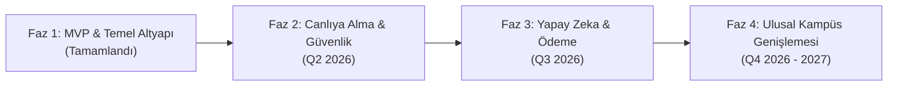
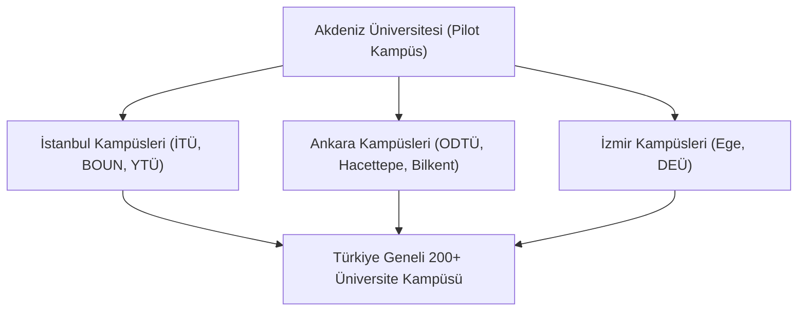

# 🗺️ Versity — Üniversiteler Arası Araç Paylaşımı (Ride Sharing) Stratejik Ürün ve Mühendislik Yol Haritası (Roadmap)

## 📌 1. Vizyon ve Genel Bakış
**Versity**, üniversite öğrencilerinin kampüs ve kent merkezleri arasındaki ulaşım ihtiyaçlarını güvenli, ekonomik, çevre dostu ve sosyal bir şekilde karşılamalarını sağlayan akıllı bir mobil araç paylaşım (carpooling) platformudur.

Bu belge; uygulamanın tamamlanan **MVP (Minimum Viable Product)** aşamasından başlayarak, canlıya alma (**Production**), ölçeklenme ve Türkiye geneli kampüs genişlemesini kapsayan uçtan uca teknik ve ürün yol haritasını içermektedir.

---

---

## 🚀 Faz 1: MVP & Temel Altyapı (Tamamlanan Aşama — Q1 2026)

| Modül / Özellik | Açıklama & Teknik Detay | Durum |
| :--- | :--- | :---: |
| **Karanlık Tema (Vanta Dark UI)** | `#0C0C0F` vanta-black teması, elektrik mavisi vurgular, duyarlı (responsive) layout | ✅ Tamamlandı |
| **Gelişmiş Performans Optimizasyonu** | `LiveClockWidget` ile re-render izolasyonu, `HitTestBehavior.opaque` dokunmatik tepkisellik | ✅ Tamamlandı |
| **Harita & Konum Servisi** | OpenStreetMap (Nominatim API) entegrasyonu ve Antalya/Alanya coğrafi sınırlandırması | ✅ Tamamlandı |
| **Sürücü & Araç Modülü** | Kişiselleştirilmiş sürücü kuralları, araç galerileri (Maserati, Audi, Mini, Clio, Egea) | ✅ Tamamlandı |
| **İlan Oluşturma Motoru** | Akıllı Slider (200–260 TL), tarih/saat seçicileri ve kapasite sayacı | ✅ Tamamlandı |
| **Koltuk Rezervasyonu & QR Kod** | Dinamik koltuk düşüşü, biniş QR kodu üretimi ve Yolculuklarım sekmesi | ✅ Tamamlandı |
| **Bulut Servisleri Entegrasyonu** | `FirebaseService` (Firebase Auth + Cloud Firestore) altyapısı | ✅ Tamamlandı |

---

## 🔒 Faz 2: Canlıya Alma, Doğrulama & Güvenlik (Q2 2026)

Bu fazın temel amacı, canlıya geçiş öncesinde kullanıcı güvenliğini ve platform içi iletişimi üst seviyeye çıkarmaktır.

### 2.1. Kimlik ve Öğrenci Doğrulama Sistemleri
* **e-Devlet & Öğrenci Belgesi Entegrasyonu**: Yalnızca aktif `.edu.tr` e-postasına sahip öğrencilerin ve akademisyenlerin sisteme kabul edilmesi.
* **Ehliyet & Ruhsat Doğrulaması**: Şoför kimliğini doğrulayan sürücü belgesi ve araç ruhsat tarama modülü.

### 2.2. Canlı Mesajlaşma & Bildirim Servisleri
* **Sürücü - Yolcu İçi Chat**: Biniş noktası ve saat teyidi için uygulama içi şifreli anlık mesajlaşma (WebSocket / Firestore Chat).
* **Anlık Push Bildirimler (FCM)**: Koltuk rezerve edildiğinde veya sürücü yola çıktığında anlık push bildirim gönderimi.

### 2.3. Derecelendirme ve Rozet Sistemi
* **5 Yıldızlı Değerlendirme & Yorumlar**: Yolculuk tamamlandıktan sonra karşılıklı puanlama.
* **Şoför Seviye Rozetleri**: *Başlangıç, Güvenilir, Yıldız* ve *Elit Şoför* puanlama mekanizması.

### 2.4. Güvenlik & Acil Durum (SOS)
* **Canlı Rota Takibi**: Yolculuk esnasında konumun seçilen aile/arkadaş kişileriyle canlı paylaşılması.
* **SOS Acil Durum Butonu**: Tek tıkla güvenlik birimlerine ve kampüs güvenliğine konum iletme.

---

## ⚡ Faz 3: Yapay Zeka, Cüzdan & Ölçeklenme (Q3 2026)

### 3.1. Yapay Zeka Destekli Akıllı Rota Eşleştirme (AI Matching Engine)
* **Sapma Açısı Hesaplama**: Şoförün mevcut rotasını minimum düzeyde saptıran yolcuları otomatik öneren makine öğrenmesi algoritması.
* **Zaman Pencereli Eşleşme**: Ders programı saatlerine göre otomatik sabah/akşam yol arkadaşı eşleştirmesi.

### 3.2. Dijital Cüzdan ve Otomatik Masraf Paylaşımı (Versity Pay)
* **Kredi Kartı / BKM Express Entegrasyonu**: Uygulama içi güvenli ödeme altyapısı.
* **Otomatik Masraf Bölüşümü**: Yakıt ve otoyol ücretlerinin yolcular arasında eşit bölünmesi.
* **Öğrenci İndirim Kuponları & Kampüs Puan**: Kahve sponsorlukları ve kampüs içi harcama puanları kazanımı.

### 3.3. Dinamik Fiyatlandırma Motoru (Dynamic Pricing)
* Mesafe, anlık yakıt fiyatları, araç sınıfı ve talep yoğunluğuna göre adil tavan/taban fiyat belirleme.

---

## 🌐 Faz 4: Ulusal Kampüs Genişlemesi & Sürdürülebilirlik (Q4 2026 — 2027)

### 4.1. Türkiye Geneli Üniversite Hatları
* İstanbul, Ankara, İzmir, Eskişehir ve Bursa başta olmak üzere tüm devlet ve vakıf üniversitelerine hat açılması.
* Şehirlerarası üniversite transfer rotalarının (Örn: *Eskişehir ➔ Ankara*) sisteme dahil edilmesi.

### 4.2. Yeşil Kampüs & Karbon Ayak İzi Takibi (ESG)
* **CO2 Emisyon Tasarrufu Hesaplayıcı**: Ortak yolculuklar sayesinde engellenen karbon miktarının kullanıcı profilinde gösterilmesi.
* **Çevre Dostu Öğrenci Sertifikası**: Rektörlükler ve çevre kulüpleriyle ortaklaşa sürdürülebilirlik rozetleri verilmesi.

### 4.3. Üniversite Kulüp & Etkinlik Entegrasyonu
* Bahar şenlikleri, festival, konser, spor müsabakaları ve teknik geziler için toplu araç paylaşım gruplarının oluşturulması.

---

## 📈 Başarı Metrikleri (KPIs)

| Metrik | Faz 1 (MVP) | Faz 2 (Canlı) | Faz 3 (AI/Pay) | Faz 4 (Ulusal) |
| :--- | :---: | :---: | :---: | :---: |
| **Aktif Öğrenci Sayısı** | 500+ | 10.000+ | 50.000+ | 500.000+ |
| **Tamamlanan Yolculuk** | 100+ | 5.000+ | 30.000+ | 300.000+ |
| **Aktif Kampüs Sayısı** | 1 (Akdeniz Üni) | 3 Kampüs | 15 Kampüs | 100+ Kampüs |
| **Kullanıcı Memnuniyeti** | 4.8 / 5 | 4.8 / 5 | 4.9 / 5 | 4.9 / 5 |
